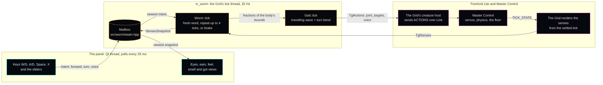
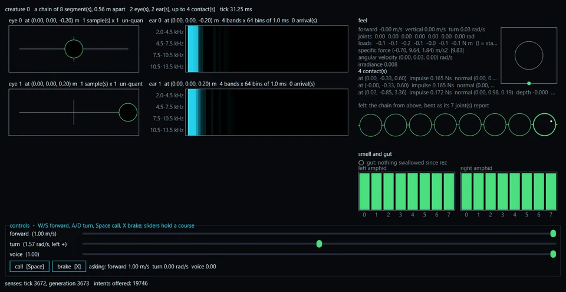

# rc-worm

A remote-controlled glass-neon mecha-worm which plugs into TronGrid Lite as a Program.

**In one sentence:** rc-worm is a small C++ library the TronGrid Lite world loads as a robot worm of
eight segments, which you steer from a Qt panel - your forward and turn become a travelling wave of
joint angles, and everything the worm senses comes back to the panel.

*The worm's real gait code, ticked at the Grid's 32 Hz: each row is one joint's servo target. Forward
runs a wave down the body (the orange crests step towards the tail), a turn bends every joint the
same way on top of it, and letting go relaxes the wave. Drawn by
[`tools/gait_figure`](tools/README.md#gait_figure), byte for byte the same on every rerun.*

## Start here

- **Build and test**, from a Visual Studio x64 shell with Qt 6.11.2 at `C:\Qt\6.11.2`:
  `cmake --workflow --preset windows-msvc` (configure, build and test, Debug and Release). On
  Linux: `cmake --preset linux-gcc -DCMAKE_PREFIX_PATH=~/Qt/6.11.2/gcc_64`, then
  `cmake --workflow --preset linux-gcc`. No Qt at all? Add `-DRC_WORM_PANEL=OFF` to the configure.
- **Deploy** beside the Grid: `cmake --install build/windows-msvc --config Release --prefix build/windows-msvc-deploy`,
  then `python tools/check_deploy.py build/windows-msvc-deploy/programs`, and copy that directory's
  contents into the Grid's `programs/`. [docs/DEV_ENV_SETUP.md](docs/DEV_ENV_SETUP.md) walks every
  step from nothing, and [docs/FIRST_LIFE.md](docs/FIRST_LIFE.md) is how you then live a life with it.
- **Pick something to do:** the
  [good first issues](https://github.com/ai-quokka-wannabe/rc-worm/issues?q=is%3Aopen+label%3A%22good+first+issue%22)
  are sized for a first pull request, and [CONTRIBUTING.md](CONTRIBUTING.md) says how one is made
  and how you are credited.

## The Loop

What one tick does, from the User's keys to the worm's servos and back - every box is code in this
repository or a sibling's:

The tick never waits for the panel, and the panel never sees more than the senses carry:
[docs/PANEL.md](docs/PANEL.md) has the threads, the seam and the silence rule, and the flagship's
[docs/TOPOLOGY.md](https://github.com/ai-quokka-wannabe/tron-grid-lite/blob/main/docs/TOPOLOGY.md)
the tick between the Grid and Master Control.

## What a Program Is

The first inhabitant of the Grid. A Program is a shared library the Grid loads through its
Program ABI (`tgl_program_abi.h`): it is handed a body, it receives what that body senses
every tick - its eyes, its ears, its feel of the floor - and it answers with what the body
should do. This Program's brain is a User at a control panel: a Qt window shows the User what
the worm sees and hears, and the User steers. Remote-controlled, because the first creature
to live in a world should be one whose every action somebody can explain. Steered from that
panel, the worm is also the first step on the human side of the organisation's
[long arc](docs/VISION.md).

## The Four Repositories

rc-worm is one of four repositories in the
[ai-quokka-wannabe](https://github.com/ai-quokka-wannabe) organisation.
[tron-grid-lite](https://github.com/ai-quokka-wannabe/tron-grid-lite) is the Grid - the
renderer, the senses and both client roles, and the home of the Program ABI this repository
builds against; [master-control](https://github.com/ai-quokka-wannabe/master-control) is the
world server every instance of the Grid answers to; [the link repository](https://github.com/ai-quokka-wannabe/link)
is the wire between them. Who owns what, and why every delegation is the way it is, lives in the
flagship's [docs/TOPOLOGY.md](https://github.com/ai-quokka-wannabe/tron-grid-lite/blob/main/docs/TOPOLOGY.md) —
one table, kept in one place, pointed at from everywhere. Where the four are headed together -
one persistent Grid where AI creatures live and human Users enter with avatars to meet them, a
multi-year arc taken in baby steps - is told on the organisation's
[landing page](https://github.com/ai-quokka-wannabe) and, with this worm's part in it, in
[docs/VISION.md](docs/VISION.md).

## What Lives Here Today

**The Program that loads.** `rc_worm.dll` / `librc_worm.so`: one exported symbol,
`tglGetProgramVTable`, behind which a worm is rezzed, ticked and derezzed exactly as the Program
ABI states - vanilla C++20, `noexcept` at every boundary, answering every tick with the angles
its own gait asks of its servos. It builds on every compiler the flagship supports with every Qt
kit on the owner's machine - and, on the runners, with Qt fetched by the repository's own
composite action (aqtinstall through `pipx`, pinned; GitHub-owned actions only) - and every one
of those libraries loads in the MSVC-built Grid: `TronGridLite --list-programs` said USABLE for
all of them when the worm first loaded, at ABI version 6 (the vendored ABI is at version 11
today), and a `--program rc_worm` host run against Master Control rezzed the worm, ticked it two
hundred times and left with BYE - a first life, recorded to a Disk, that Clu re-simulates and
agrees with.

*The panel during a live life. Read it honestly: the sliders ask for 1.00 m/s, yet the body reports
0.00 - the world dropped the late intents
([tron-grid-lite#170](https://github.com/ai-quokka-wannabe/tron-grid-lite/issues/170)), and the smell
bars sit full at a dense 0.43 orbs per 100 m^2. Both are open; the panel is how you see them.*

**The panel.** The User is the brain: a Qt Widgets window on the Program's own thread shows
what the worm senses - eyes where they look, ears as the histograms they are with every
arrival marked, the feel of the floor from above, the two amphids' smell as bars and the gut's
count of every bite - and takes forward, turn and voice from keys
or sliders scaled to the body's bounds. The tick never waits for it: a vanilla-C++20 mailbox of
plain structs sits between them, and a worm nobody steers repeats four ticks and brakes. It
deploys beside `rc_worm.dll` with `windeployqt`, judged a closed set by `tools/check_deploy.py`,
and the Grid loads it with no Qt on the PATH. [docs/PANEL.md](docs/PANEL.md) carries the
threads, the seam and the why. [docs/FIRST_LIFE.md](docs/FIRST_LIFE.md) and
`tools/first_life.ps1` are how a life is lived and recorded: Master Control, the window, the
host, the panel in your hands, Clu at the end.

**The body.** One segment of eight: a regular icosahedron a quarter metre in circumradius,
near-black mirror faces and a green neon tube along every one of its thirty edges, built from the
golden ratio in vanilla C++20 and lent to the Grid at `program_rez`, with the joint stubs
authored here on the two spikes that meet. It rests on a spike with its nose where the eyes
look, passes every rule the Grid and the world judge a model by before either sees it, and
stands grounded in Master Control's world. The chain is the world's to move - a servo at every
joint and every segment meeting the floor for itself - and the Grid's to draw: in the window,
green-edged icosahedra mirrored in the floor. [docs/BODY.md](docs/BODY.md) carries the numbers
and the why. The panel and the life somebody lives are staged in [TODO.md](TODO.md).

## The Doctrine

- **A Program perceives only what its body senses.** No scene graph, no world state, no side
  door: the senses the ABI hands over are the whole of what the worm knows, and the User at the
  panel sees exactly that and nothing more.
- **The body is the Program's own.** `program_rez` brings the worm's shape to the Grid, and the
  Grid validates it whole or refuses it by name.
- **Vanilla C++20, Qt only in the panel.** The Program, its body and the seam between the tick
  and the window are standard C++; Qt classes live in the panel module alone, and the worm
  builds and loads without it.
- **Remote-controlled first.** The User is the brain. A worm whose every action has a human
  behind it is the creature a world is debugged with; a thinking one comes after, in its own
  repository, wearing this body. That does not retire the panel: it is v0 of the human client,
  not a throwaway.
- **Cross-toolchain, deliberately.** The Grid is built with MSVC; this Program builds on every
  compiler the flagship supports and every Qt kit on the owner's machine - MSVC, clang-cl,
  MinGW, LLVM-MinGW, GCC and Clang - so the C ABI between a Program and the Grid is proven
  across compilers rather than assumed within one.

## Building

The commands are in [Start here](#start-here) and, step by step, in
[docs/DEV_ENV_SETUP.md](docs/DEV_ENV_SETUP.md); the flagship's
[RUNNING_THE_GRID.md](https://github.com/ai-quokka-wannabe/tron-grid-lite/blob/main/docs/RUNNING_THE_GRID.md)
stands the whole ecosystem up around the worm.

CMake 3.25+, Ninja, a C++20 compiler, and - for the panel - Qt 6.11 for the kit of the preset
(`RC_WORM_PANEL=OFF` builds the worm with no Qt at all). The presets are the flagship's:
`windows-msvc`, `windows-clang-cl`, `windows-mingw`, `windows-llvm-mingw`, `linux-gcc`,
`linux-clang`, with `linux-clang-asan` and `linux-clang-tsan` beside them; `cmake --workflow
--preset <preset>` configures, builds and tests Debug and Release.

The library lands in `build/<preset>/bin/<config>/`; copy it into the Grid's `programs/`
directory beside `TronGridLite` and run `TronGridLite --program rc_worm`. With the panel built
on Windows, install it instead: `cmake --install` runs `windeployqt` beside the library,
`tools/check_deploy.py` judges the set, and the Grid loads it with no Qt on the PATH
([docs/PANEL.md](docs/PANEL.md#deployment)).

## Contributors

Everyone who helps is credited here, for any kind of contribution: code, documentation, bug reports,
reviews, ideas, answers in Discussions. The list follows the
[All Contributors](https://allcontributors.org/en/reference/specification/) specification and is kept by hand;
[CONTRIBUTING.md](CONTRIBUTING.md#credit-and-copyright) says how to add yourself. Contributors keep the
copyright of what they write.

| Contributor | Contributions |
|-------------|---------------|
| [Matej Gomboc](https://github.com/MatejGomboc) | 💻 📖 🎨 🤔 🔬 🚇 🚧 ⚠️ |

The emoji follow the [All Contributors emoji key](https://allcontributors.org/en/reference/emoji-key/).

## Licence

Copyright © 2026 The AiQuokkaWannabe Authors <https://github.com/ai-quokka-wannabe/rc-worm>, listed under [Contributors](#contributors).

This program is free software: you can redistribute it and/or modify
it under the terms of the GNU General Public License as published by
the Free Software Foundation, either version 3 of the License, or
(at your option) any later version.

This program is distributed in the hope that it will be useful,
but WITHOUT ANY WARRANTY; without even the implied warranty of
MERCHANTABILITY or FITNESS FOR A PARTICULAR PURPOSE. See the
GNU General Public License for more details.

See the attached [LICENCE](LICENCE) file for more info.

---

End of line.
